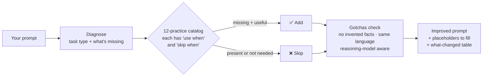

<p align="center">
  <picture>
    <source media="(prefers-color-scheme: dark)" srcset=".github/assets/banner-dark.svg">
    
  </picture>
</p>

<p align="center">
  <a href="https://github.com/stanislav-fedyna-dev/just-enough-prompt/releases"></a>
  <a href="https://github.com/stanislav-fedyna-dev/just-enough-prompt/actions/workflows/validate.yml"></a>
  <a href="https://agentskills.io"></a>
  <a href="https://skills.sh/stanislav-fedyna-dev/just-enough-prompt"></a>
  <a href="LICENSE"></a>
</p>

<p align="center">
  <a href="#install">Install</a> · <a href="#how-it-works">How it works</a> · <a href="#example">Example</a> · <a href="plugin/skills/just-enough-prompt/SKILL.md">Read the skill</a>
</p>

---

**An agent skill that improves your prompts the way a good editor would: by fixing what's missing, not by rewriting everything.**

Most prompt "improvers" bolt every technique onto every prompt: a role, few-shot examples, "think step by step", a wall of constraints. The result is longer, not better. This skill checks your prompt against 12 practices, applies **only the ones it actually lacks**, and shows a short table of what it **added**, what it **skipped**, and why. You learn something every time you use it.

Works with Claude (claude.ai, Claude Code, API) and any agent that supports the open [Agent Skills](https://agentskills.io) format.

## Example

**You:** improve this prompt: `write an email about the project delay`

**Agent:**

> **🔍 Diagnosis** — No context, tone or length. The model will invent a reason and dates, and guess how formal to be.
>
> **✅ Improved prompt**
> ```text
> Write a professional email to a client telling them the project is delayed by [length of delay].
>
> Context: the delay is caused by [reason]. The original deadline was [original date]; the new one is [new date].
>
> Tone: professional, transparent and solution-focused, not defensive.
>
> Include: the new timeline, a brief reason without jargon, our next steps,
> and an apology that doesn't over-apologize. At most 150 words.
> ```
> Fill in before using: `[length of delay]`, `[reason]`, `[original date]`, `[new date]`
>
> **📋 What changed**
>
> | Practice | Applied | Why |
> |---|---|---|
> | Context | ✅ Added | the email depends on facts the model can't guess, so they're placeholders, not invented |
> | Tone | ✅ Added | delay emails go wrong when defensive |
> | Constraints | ✅ Added | what to include + length cap |
> | Role | ❌ Skipped | a clear task and tone already do the job |
> | Few-shot | ❌ Skipped | one email, no pattern to imitate |

## How it works



### The 12 practices

| | | |
|---|---|---|
| 1. Role | 5. Audience | 9. Tone and style |
| 2. Clear instruction | 6. Few-shot examples | 10. Delimiters and structure |
| 3. Context | 7. Reasoning trigger | 11. Success criteria |
| 4. Output format | 8. Constraints | 12. Specificity over vagueness |

### Built-in safeguards

- **Never invents facts.** Dates, names and numbers you didn't give become `[placeholders]` with a "fill in before using" list.
- **Keeps your language and intent.** A Ukrainian prompt comes back in Ukrainian.
- **Knows modern models.** No "think step by step" for reasoning models; explains *why* instead of SHOUTING.
- **Doesn't over-engineer.** A prompt that needs one fix comes back with one fix.

## Install

### Claude.ai / Claude desktop app
1. Download `just-enough-prompt.zip` from [Releases](https://github.com/stanislav-fedyna-dev/just-enough-prompt/releases).
2. Make sure **Code execution / Create and edit files** is on in **Settings → Capabilities**.
3. Go to **Customize → Skills** → **+** → **Create skill** → **Upload a skill**, select the zip, and toggle it on.

### Claude Code
```bash
/plugin marketplace add stanislav-fedyna-dev/just-enough-prompt
/plugin install just-enough-prompt@just-enough-prompt
```

### Any agent (Cursor, Codex, Gemini CLI, Copilot, OpenCode, …)
```bash
npx skills add stanislav-fedyna-dev/just-enough-prompt
```

### Manually
Copy `plugin/skills/just-enough-prompt/` into your agent's skills folder, e.g. `~/.claude/skills/just-enough-prompt/`.

## Usage

Just ask: "improve this prompt", "why doesn't this prompt work?", "review my system prompt", "turn this into a proper prompt". Any language works.

## Repository layout

```text
.
├── .claude-plugin/
│   └── marketplace.json       # lets this repo act as its own marketplace
├── plugin/                    # the plugin itself (what gets installed)
│   ├── .claude-plugin/
│   │   ├── plugin.json        # plugin manifest
│   │   └── icon.png           # listing icon (1024×1024)
│   ├── skills/
│   │   └── just-enough-prompt/
│   │       ├── SKILL.md       # the skill: catalog, workflow, gotchas, examples
│   │       ├── references/    # techniques + anti-patterns, loaded on demand
│   │       └── evals/         # quality and trigger test cases
│   ├── README.md
│   └── LICENSE
├── scripts/
│   ├── validate.py            # spec checks (also runs in CI)
│   └── make_banner.py         # regenerates the animated banners
├── .github/                   # CI, release workflow, issue template, README assets
├── CHANGELOG.md
├── PRIVACY.md
├── LICENSE
└── README.md
```

## Testing

```bash
python scripts/validate.py   # frontmatter and file checks per the Agent Skills spec
```

Behaviour tests live in `plugin/skills/just-enough-prompt/evals/`: `evals.json` (output quality, with assertions) and `trigger-queries.json` (should / shouldn't activate). See [Evaluating skills](https://agentskills.io/skill-creation/evaluating-skills).

## Contributing

Got a rewrite that over-engineered, invented facts, or missed the real problem? Open an issue with the prompt and the output. Good cases go into `evals/` first, then into the skill.

## Acknowledgements

The practice catalog draws on the [Prompt Engineering Guide](https://www.promptingguide.ai) by [DAIR.AI](https://github.com/dair-ai/Prompt-Engineering-Guide) (MIT) and on model vendors' published prompting guidance.

## License

[MIT](LICENSE)
